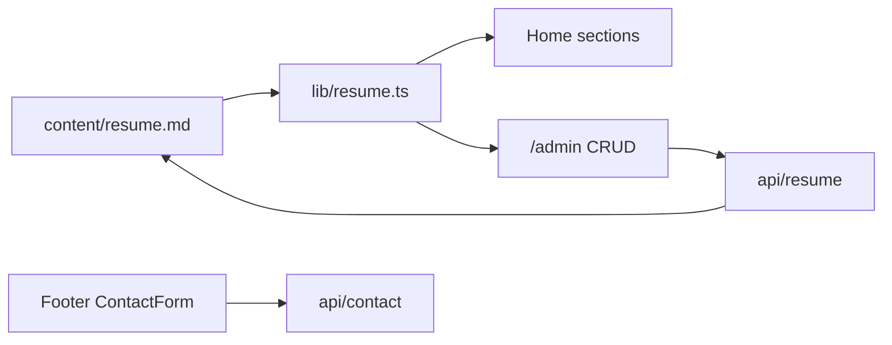

# Robotics Portfolio (React + Markdown + Admin)

## Decisions (locked)

- **Stack:** Next.js App Router + React + TypeScript + Tailwind CSS (React as requested; Next.js gives API routes for `/admin` and the contact form).
- **Language:** English only.
- **Theme:** Red (`#E10600`) and near-black (`#0A0A0A`) robotics / HUD look — grid lines, subtle scan accents, geometric frames. Portrait framed in a tech HUD, not a plain rounded card.
- **Content source:** `[content/resume.md](content/resume.md)` only. Portrait at `public/images/portrait.jpg` (copied from `[1000013127.png](1000013127.png)`).
- **Icons:** `lucide-react` for nav, contact, skills, social, and admin actions.
- **Admin:** Password-protected `/admin` that reads/writes `content/resume.md` via API (no separate database).
- **Contact:** Footer form posts to `/api/contact` (validated English fields); delivery via Resend when `RESEND_API_KEY` is set, otherwise saved to `content/messages.json` for local use.

Existing Cursor rules stay: `[portfolio-source.mdc](.cursor/rules/portfolio-source.mdc)`, `[resume-markdown.mdc](.cursor/rules/resume-markdown.mdc)`. Add one React/admin rule during build.

## Phase 1 — Content first (before UI code)

Fill `[content/resume.md](content/resume.md)` from `[Akash_Ravat_resume.pdf](Akash_Ravat_resume.pdf)` (no invented facts):


| Field    | Value from resume                                           |
| -------- | ----------------------------------------------------------- |
| name     | Akash Ravat                                                 |
| role     | Full-Stack & Machine Learning Developer                     |
| location | Ahmedabad, Gujarat                                          |
| email    | [akashravat5461@gmail.com](mailto:akashravat5461@gmail.com) |
| phone    | 6355879969                                                  |
| linkedin | akashravat2712                                              |
| github   | akashravat2712                                              |
| photo    | `/images/portrait.jpg`                                      |


Sections to encode: Professional Summary → About; Technical Skills; Experience (CreArt, Infolabz, NicheTech); Projects (Uber Analytics, AI Resume Screening, Startup Failure Prediction, Business Support Portal); Education (Diploma + B.E.); Contact line.

Copy photo → `public/images/portrait.jpg`. Remove temp PDF extract files (`_pdf_extract.txt`, `_pdf_clean.txt`) if present.

## Phase 2 — App scaffold

```
app/
  layout.tsx, page.tsx, globals.css
  admin/page.tsx
  api/resume/route.ts
  api/admin/login/route.ts
  api/contact/route.ts
components/
  Navbar, Footer, ContactForm
  Hero, About, Skills, Experience, Projects, Education
  admin/AdminDashboard
lib/
  resume.ts          # parse + serialize content/resume.md
  auth.ts            # cookie session from ADMIN_PASSWORD
content/resume.md
public/images/portrait.jpg
.env.example         # ADMIN_PASSWORD, RESEND_API_KEY, CONTACT_TO
```

- `lib/resume.ts`: parse frontmatter + labeled Experience/Projects blocks; serialize the same shape back for admin saves.
- Home page: server-read markdown → render sections. No hardcoded bio/jobs in components.

## Phase 3 — Public UI (robotics)




- **Navbar:** sticky, black/red; links About, Skills, Experience, Projects, Education, Contact; brand “Akash Ravat”; mobile menu with icons.
- **Hero:** name as brand-level signal, role, one tagline from markdown, portrait in robotics frame, CTAs (Projects / Contact). Subtle grid + red accent motion (2–3 intentional animations).
- **Sections:** one job each — Skills with icon groups (code, brain, database, bot); Experience/Projects timelines; Education.
- **Footer:** social icons (GitHub, LinkedIn, Mail, Phone) + **Contact form** (name, email, message, submit) in English.
- Responsive desktop + mobile.

## Phase 4 — `/admin`

- Login with `ADMIN_PASSWORD` → httpOnly session cookie.
- Dashboard tabs: Profile, About, Skills, Experience, Projects, Education.
- Add / edit / delete experience and projects; edit skills and frontmatter; **Save** writes `content/resume.md` through `lib/resume.ts` serializer.
- Home revalidates after save so public page stays in sync.

## Phase 5 — Rules + env

- Add `.cursor/rules/portfolio-react.mdc`: Next.js App Router, Tailwind tokens for red/black, Lucide icons, never hardcode resume facts.
- `.env.example` documenting `ADMIN_PASSWORD`, optional Resend keys.
- `README.md` with run steps: `npm install`, `npm run dev`, fill env, open `/` and `/admin`.

## Build order when you approve

1. Fill markdown + copy portrait
2. Scaffold Next.js + deps
3. Parser + public pages (navbar → sections → footer/form)
4. Admin auth + CRUD
5. Theme polish + icons + verify against resume

## Out of scope

- Bilingual UI  
- Public signup / multi-user CMS  
- Deploy wiring (can add later on Vercel)

